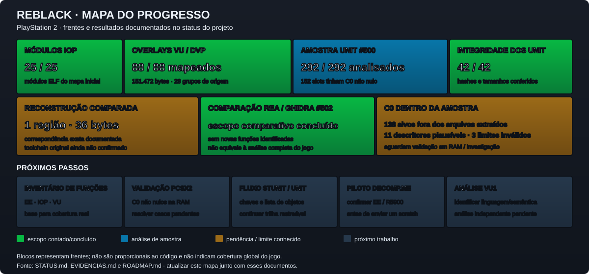

# Projeto ReBlack

Acompanhamento privado da engenharia reversa e decompilação da versão PlayStation 2 de BLACK.

> Este repositório é um painel de progresso e documentação. Ele não contém a ISO, arquivos extraídos do jogo, executáveis, dumps de memória ou pseudocódigo derivado do jogo.

## Situação atual

Consulte [STATUS.md](STATUS.md) para o painel resumido, [ROADMAP.md](ROADMAP.md) para a sequência de trabalho e [EVIDENCIAS.md](EVIDENCIAS.md) para os resultados que sustentam as afirmações.

**Percentual global:** ainda não calculável com rigor. Primeiro precisamos inventariar as funções únicas do executável e classificar cada uma. Percentuais de amostras ou etapas não representam o jogo inteiro.

## Mapa visual do progresso

> As cores indicam o estado de cada frente dentro do escopo documentado. Os blocos não representam tamanho de código nem cobertura global. Os números e pendências devem acompanhar as atualizações de STATUS.md, EVIDENCIAS.md e ROADMAP.md.

## Como o GitHub e o decomp.me serão usados

O GitHub guarda o estado do projeto, decisões, evidências resumidas e tarefas futuras. O decomp.me é uma ferramenta web para comparar uma função de cada vez com assembly, usando um compilador e opções compatíveis. Não há sincronização automática entre os dois: quando um scratch for usado, registraremos seu link, configuração, resultado e decisão aqui.

Antes de enviar qualquer trecho ao decomp.me, verificaremos o compilador EE/R5900 disponível e como o scratch é armazenado/compartilhado. A política do serviço informa que os dados salvos são mantidos ligados à sessão e que exportações públicas podem incluir dados que já estejam públicos no site: [política de privacidade do decomp.me](https://www.decomp.me/privacy). O piloto não deve conter material do jogo sem essa verificação.

## Atualizações

Cada avanço relevante será registrado em um commit com data, frente afetada, evidência, resultado e próximo passo. A lista fica em [ATUALIZACOES.md](ATUALIZACOES.md).
